# 星海 XingHai · 项目完整文档
> 短视频 + 直播 + 电商一体化全栈项目（用户端 / 创作者中心 / 管理后台 / 后端服务）

## 1. 文档信息
| 项目 | 内容 |
|---|---|
| 文档名称 | 星海项目完整文档 |
| 文档版本 | 1.3.0 |
| 更新日期 | 2026-10-25 |
| 适用项目版本 | v1.2.0（企业化升级与 UI 重构版，2026-10-24） |
| 适用代码路径 | `F:\AI_full-stack_project\XingHai` |
| 读者对象 | 全栈开发者、测试人员、运维人员、项目评审者 |
| 文档定位 | 项目唯一总文档：概述、功能、架构、流程、数据库、接口、部署、测试、账号与版本记录 |
| 事实来源 | 后端 Java 源码、`application*.yml`、`database/*.sql`、三端源码与既有项目文档 |

## 2. 项目概述
### 2.1 项目定位
星海（XingHai）是一个前后端分离的单体全栈项目，围绕「内容消费 — 内容创作 — 平台运营」构建闭环：

- 普通用户观看短视频、点赞收藏评论、关注创作者、私信聊天、观看直播、进入店铺下单；
- 创作者发布作品、查看经营数据、经营店铺与商品、处理订单、管理直播；
- 平台管理员完成内容审核、举报处理、用户与角色权限治理、公告与广告运营；
- 后端服务统一提供 REST API、JWT 鉴权、RBAC 权限、文件上传、Redis 缓存与限流。

设计原则是「不引入重型中间件、单机即可跑通」：仅依赖 MySQL 与 Redis，不引入消息队列、搜索引擎与微服务框架，适合作为全栈工程实践、毕业设计或企业级开发规范参考。

### 2.2 四个工程
| 工程 | 端 | 端口 | 技术栈 | 职责 |
|---|---|---|---|---|
| `backend` | 后端服务 | 8080 | Spring Boot + MyBatis-Plus | REST API、鉴权、上传、缓存、限流、统计 |
| `web-user` | 用户端 | 5173 | Vue 3 + Vite | 信息流、播放、互动、私信、直播、商城、个人中心 |
| `web-creator` | 创作者中心 | 5174 | Vue 3 + Vite + ECharts | 数据看板、作品、店铺、商品、订单、直播 |
| `web-admin` | 管理后台 | 5175 | Vue 3 + Vite + ECharts | 数据大盘、审核、举报、用户、角色权限、运营 |

辅助目录：`database/`（建表、种子数据、索引脚本、冒烟测试）、`deploy/`（Nginx 配置）、`uploads/`（本地上传文件）、`docs/`（文档与截图）、`sql/`（容器初始化脚本）。

### 2.3 项目规模
| 指标 | 数量 | 说明 |
|---|---|---|
| 数据表 | 21 张 | 系统域 5 张 + 业务域 16 张 |
| REST 接口 | 94 个 | 由 19 个控制器提供 |
| 后端控制器 | 19 个 | 见第 8.5 节 |
| 用户端视图 | 15 个 | 含登录、注册页 |
| 创作者中心视图 | 9 个 | 含登录页与布局页，业务页面 7 个 |
| 管理后台视图 | 10 个 | 含登录页与布局页，业务页面 8 个 |
| 演示账号 | 16 个 | 1 管理员 + 5 创作者 + 10 普通用户 |
| 自动化测试用例 | 18 个 | `mvn -B test` 全部通过 |

### 2.4 技术栈
| 层次 | 技术 | 版本 | 用途 |
|---|---|---|---|
| 后端框架 | Spring Boot | 2.7.18 | Web、IOC、自动配置 |
| 语言 / 构建 | JDK / Maven | 17 / 3.9 | 编译与依赖管理 |
| 持久层 | MyBatis-Plus | 3.5.3.1 | ORM、分页、逻辑删除 |
| 数据库 | MySQL | 8.0 | 业务数据存储 |
| 缓存 | Redis | 7.x | 热点缓存、限流计数、浏览去重 |
| 鉴权 | JJWT | 0.11.5 | Token 签发与解析 |
| 密码 | spring-security-crypto（BCrypt） | 5.7.11 | 密码哈希，不启用整套 Spring Security |
| 参数校验 | spring-boot-starter-validation | 2.7.18 | JSR-303 校验 |
| 前端框架 | Vue | 3.4.38 | 组合式 API（`<script setup>`） |
| 构建 | Vite | 5.4.8 | 开发服务器与生产构建 |
| UI | Element Plus | 2.9.1 | 组件库，CSS 变量定制主题 |
| 状态 / 路由 | Pinia / Vue Router | 2.3.0 / 4.4.5 | 登录态、Hash 路由 |
| 图表 | ECharts | 5.5.1 | 数据大盘与创作者看板（用户端未引入） |
| 请求 | Axios | 1.7.9 | 统一拦截器与错误处理 |
| 运行时 | Node.js | 20.x | 三端构建 |

## 3. 界面预览
截图均来自本地实际运行环境，演示数据见 `database/xinghai_data.sql`。

**用户端首页（推荐流）**：顶部为品牌、频道搜索与登录入口，中部为分类与推荐/关注/同城切换，内容区以 3:4 封面卡片展示视频。

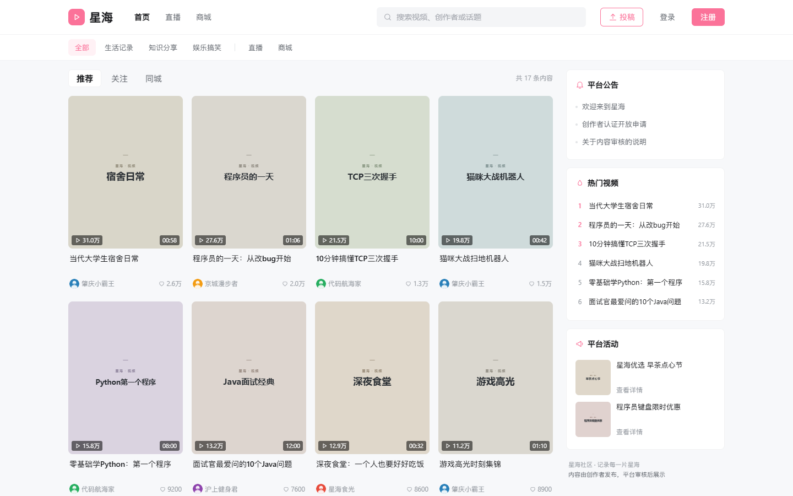

**视频播放页**：左侧为播放器、作者信息与评论区，右侧为相关推荐，底部支持上一条/下一条切换。

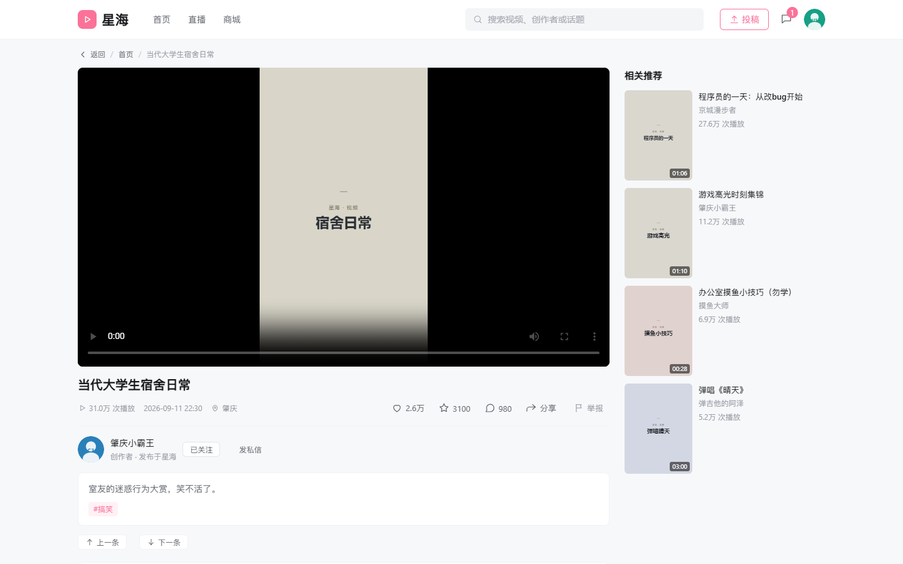

**直播广场**：卡片网格展示直播间，直播中状态以红点标识，角标展示在线人数。

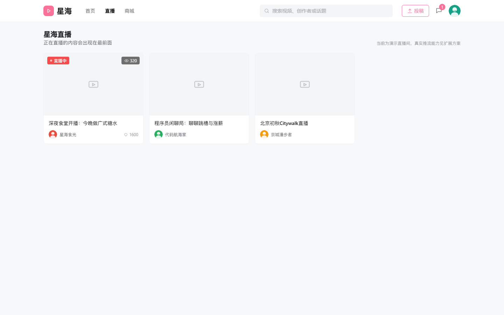

**消息中心**：双栏结构，左侧会话列表，右侧聊天窗口，支持 5 秒轮询与回车发送。

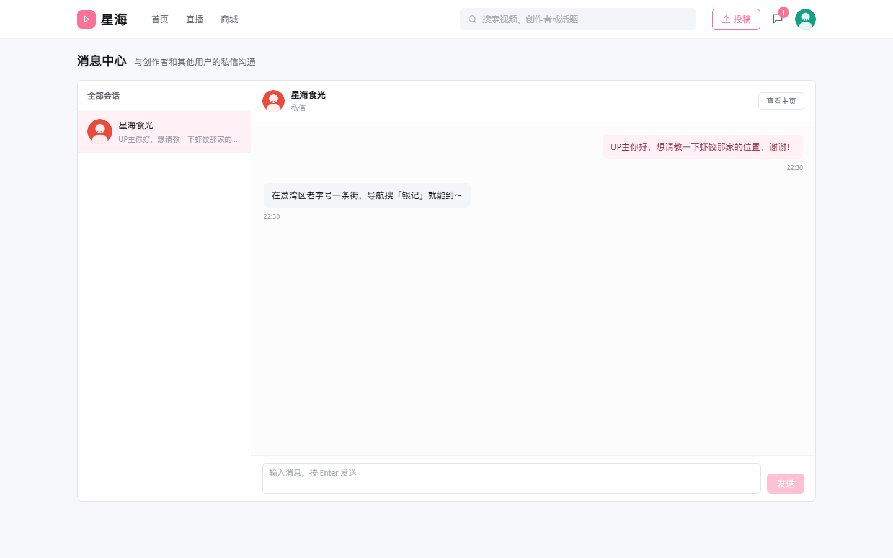

**星海商城**：顶部展示营业中店铺，下方展示在售商品，可进入店铺主页与商品详情下单。

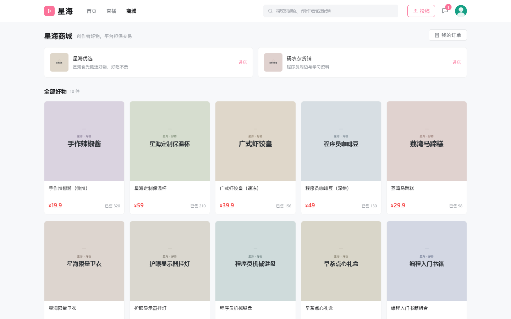

**创作者数据看板**：展示累计播放、获赞、粉丝、作品数、销售额五项指标，并以折线图呈现近 7 天趋势。

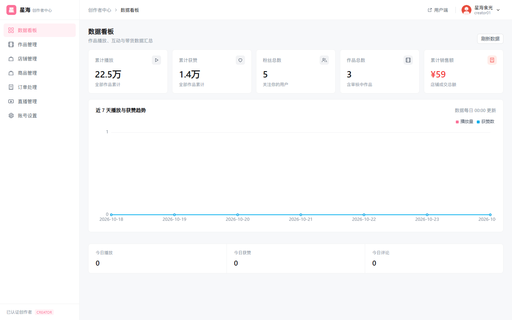

**作品管理**：列出封面、标题、播放/点赞/评论数据与审核状态，未通过作品展示驳回原因。

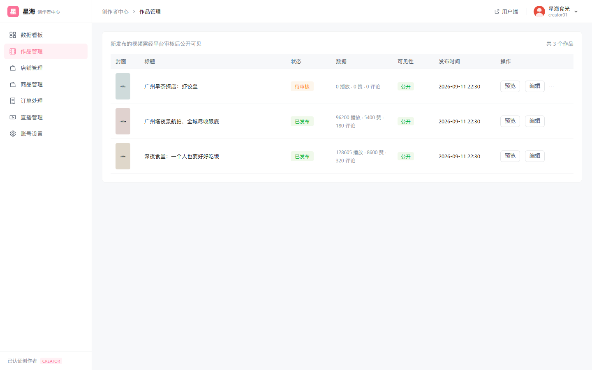

**订单处理**：本店订单按状态筛选，展示买家、商品快照、金额与收货信息，并对已付款订单执行发货。

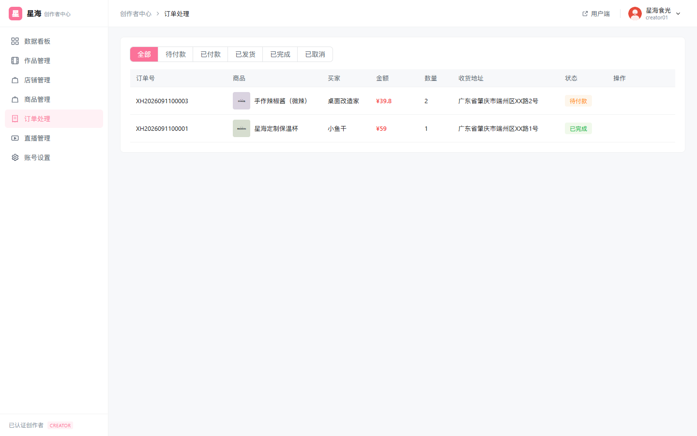

**管理后台数据大盘**：以指标卡呈现用户、创作者、视频、待审核、订单、成交额与举报，配合趋势折线与分类分布环形图。

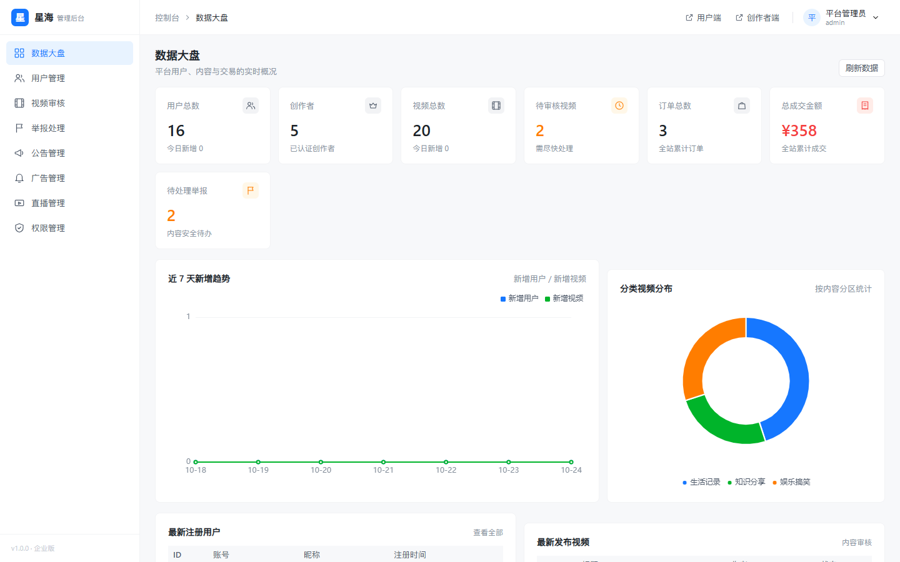

**视频审核**：支持按状态筛选作品，执行通过或驳回（驳回需填写原因），并可跳转用户端预览。

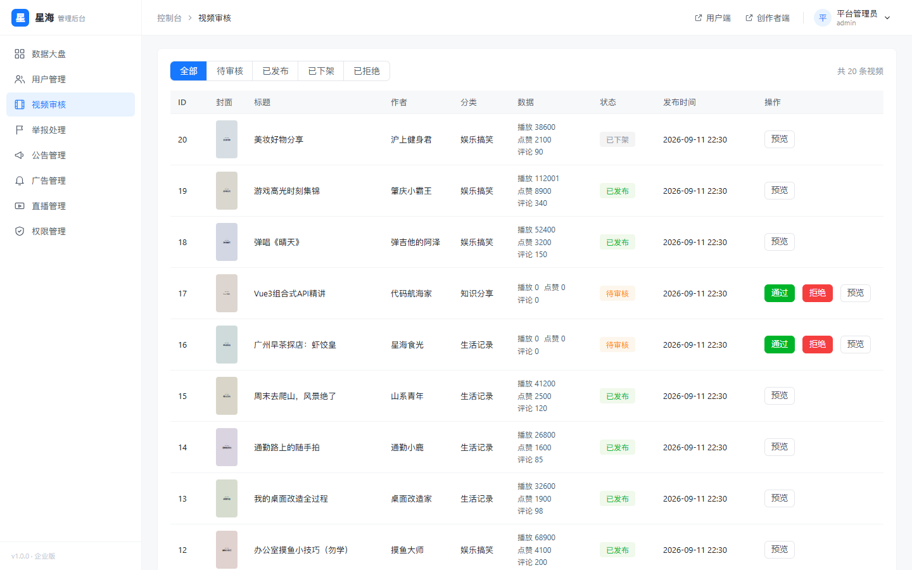

**用户管理**：用户分页与关键词搜索，支持启用/禁用、角色分配与详情查看。

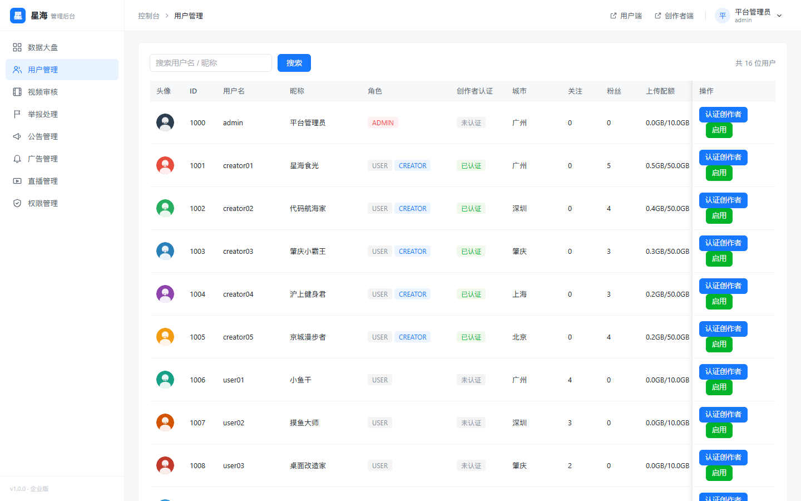

## 4. 功能清单
### 4.1 用户端
| 模块 | 能力 |
|---|---|
| 内容消费 | 推荐 / 关注 / 同城信息流、分类筛选、关键词搜索、视频详情与相关推荐 |
| 互动 | 点赞、收藏、评论（含回复）、分享、举报、关注创作者 |
| 社交 | 会话列表、聊天窗口、未读数、从他人主页携参发起会话 |
| 直播 | 直播间列表、直播状态与在线人数展示 |
| 电商 | 商城首页、店铺主页、商品详情、下单、支付（模拟）、取消、确认收货、我的订单 |
| 创作 | 上传视频与封面、填写标题/简介/分类/标签/位置、公开与评论开关、我的作品 |
| 个人 | 注册登录、个人主页、资料与头像修改、改密、我的收藏/点赞/关注/粉丝 |

### 4.2 创作者中心
| 模块 | 能力 |
|---|---|
| 数据看板 | 累计播放/获赞/粉丝/作品/销售额、今日指标、近 7 天趋势图 |
| 作品管理 | 作品列表、数据与审核状态、编辑、公开/私密切换、删除、跳转预览 |
| 店铺经营 | 开店（一人一店）、店铺资料维护 |
| 商品管理 | 新增、编辑、上下架、删除、库存与价格维护 |
| 订单处理 | 本店订单按状态筛选、发货 |
| 直播 | 开播、关播、直播记录 |

### 4.3 管理后台
| 模块 | 能力 |
|---|---|
| 数据大盘 | 用户/创作者/视频/待审核/订单/成交额/举报指标、7 天趋势、分类分布、最新注册用户与最新视频 |
| 内容治理 | 视频审核（通过/驳回）、举报处理（已处理/已驳回） |
| 用户与权限 | 用户分页与搜索、禁用/启用、角色分配、角色权限配置、权限点查看 |
| 运营 | 分类管理、标签管理、公告管理、广告位管理、直播管控 |
| 电商 | 全平台订单查询 |

### 4.4 后端服务
- 21 张数据表、94 个 REST 接口，覆盖认证、用户、视频、互动、消息、直播、电商、运营与统计。
- JWT 无状态鉴权 + `@RequireRole` 注解式 RBAC（支持类级与方法级）；ThreadLocal 用户上下文，请求结束自动清理。
- 统一响应结构、全局异常处理、参数校验、分页封装（单页上限 100）。
- 文件上传（头像/封面/商品图/视频）：扩展名白名单 + 文件头魔数 + 目录白名单 + UUID 重命名 + 配额校验。
- Redis：分类/标签/公告/广告缓存（TTL 600 秒，写操作失效，异常降级）、登录注册限流、浏览去重。

## 5. 技术架构
### 5.1 整体架构
```text
┌──────────────┐   ┌──────────────┐   ┌──────────────┐
│ 用户端 :5173 │   │创作者端:5174 │   │ 管理端 :5175 │
└──────┬───────┘   └──────┬───────┘   └──────┬───────┘
       └──────────────────┼──────────────────┘
                          │  /api、/upload
                Nginx（生产）/ Vite Proxy（开发）
                          ▼
                 Spring Boot API :8080
        ┌─────────────────┼─────────────────┐
        ▼                 ▼                 ▼
    MySQL 8.0          Redis            uploads
  （21 张业务表）   （缓存 / 限流）     （本地文件）
```
开发环境由 Vite 代理 `/api` 与 `/upload` 到 8080；生产环境由 Nginx 托管三端静态资源并反代后端。

### 5.2 后端分层
| 层 | 目录 | 职责 |
|---|---|---|
| 接口层 | `controller` | 参数接收、调用服务、返回统一结果、声明角色要求 |
| 业务层 | `service` | 业务规则、状态流转、事务、缓存读写 |
| 数据层 | `mapper` / `entity` | 21 个 Mapper 与实体，MyBatis-Plus 映射 |
| 模型层 | `dto` / `vo` | 请求模型与响应模型分离，公开信息脱敏 |
| 安全层 | `security` | JWT 拦截器、`@RequireRole`、`UserContext` |
| 基础设施 | `config` / `util` | WebMvc、Redis、MyBatis-Plus、安全响应头、JWT 与 Redis 工具 |
| 横切能力 | `common` / `exception` | `Result`、`ResultCode`、`PageResult`、全局异常处理 |

请求处理顺序：`SecurityHeadersFilter`（安全头）→ `JwtInterceptor`（解析令牌、校验用户状态、RBAC、写入上下文）→ Controller → Service → Mapper；请求结束后清理 ThreadLocal。

### 5.3 前端结构
三个前端工程采用一致的目录结构：

```text
src/
├── api/           # Axios 实例与接口函数
├── assets/        # 静态资源
├── components/    # 通用组件（图标、视频卡片、空状态等）
├── router/        # 路由表与登录守卫（Hash 模式）
├── stores/        # Pinia 登录态
├── styles/        # 设计令牌与全局样式
└── views/         # 页面
```
三端使用独立的 `localStorage` 键隔离登录态：用户端 `xh_token`、创作者中心 `xh_creator_token`、管理后台 `xh_admin_token`，可同时登录互不干扰。

### 5.4 关键设计
| 设计 | 说明 |
|---|---|
| 响应式外壳 | 用户端 62px 吸顶导航；创作者中心与管理后台 224px 固定侧栏 + 56px 面包屑顶栏 |
| 设计系统 | CSS 变量定义颜色、圆角、间距与字号，并覆盖 Element Plus 变量 |
| 视觉规范 | 主色不超过两种（用户端/创作者端品牌粉、管理端专业蓝）；4–8px 小圆角、1px 描边；不使用 emoji 与紫色渐变 |
| 图标 | 内联线性 SVG 组件，不引入重型图标库 |
| 按需加载 | 路由懒加载 + Vite `manualChunks` 拆分 vue/element-plus/echarts |
| 可选登录 | 白名单接口匿名可访问；携带合法令牌时解析用户上下文，返回 `liked`、`collected`、`followed` 等状态 |

## 6. 核心业务流程
### 6.1 登录与鉴权
```text
浏览器                        后端                          Redis / MySQL
  │  POST /api/auth/login        │                               │
  ├─────────────────────────────►│ 1. 按客户端 IP 限流计数 ─────►│
  │                              │ 2. 查询用户 + BCrypt 校验 ───►│
  │                              │ 3. 签发 JWT（subject=userId）  │
  │◄─────────────────────────────┤ 4. 返回 token 与用户信息       │
  │ 5. 前端写入 localStorage     │                               │
  │ 6. 请求头 Authorization      │                               │
  ├─────────────────────────────►│ 7. 拦截器解析并校验 Token      │
  │                              │ 8. 校验用户存在且未禁用        │
  │                              │ 9. 查询角色 → @RequireRole     │
  │                              │ 10. 写入 UserContext           │
```
- 令牌格式：`Authorization: Bearer <token>`，默认有效期 7 天（`JWT_EXPIRE=604800000` 毫秒）。
- 角色判定按逗号拆分角色编码后用 `Set` 精确匹配，避免子串误判；方法注解缺失时回退类注解。
- 未登录返回业务码 401，角色不足返回 403；令牌无效但属于白名单接口时按匿名放行。
- 用户被禁用后，已有令牌在下一次请求即失效（每次请求都校验用户状态）。
- 请求结束后 `UserContext.clear()`，防止线程复用导致用户串号。

### 6.2 投稿与审核
1. 创作者上传封面与视频（`POST /api/upload/image`、`POST /api/upload/video`），后端校验扩展名、文件头魔数与目录白名单，视频额外校验配额。
2. 文件以 UUID 重命名，落盘到 `UPLOAD_DIR/{dir}/{yyyyMMdd}/`，返回 `/upload/...` 相对路径。
3. 提交发布（`POST /api/video/publish`），视频状态置为 0（待审核），进入管理后台审核列表。
4. 管理员审核（`POST /api/video/audit`）：`pass` 置为 1（已发布），`reject` 置为 3（已拒绝）并记录驳回原因。
5. 审核通过的作品进入推荐流、分类、搜索与相关推荐；创作者端展示状态与驳回原因。

| 当前状态 | 允许操作 | 目标状态 |
|---|---|---|
| 0 待审核 | 审核通过 | 1 已发布 |
| 0 待审核 | 审核驳回 | 3 审核拒绝 |
| 1 已发布 | 下架 | 2 已下架 |
| 2 已下架 | 重新上架 | 1 已发布 |

### 6.3 信息流加载
1. 前端按 `pageNum` / `pageSize` 请求推荐、关注、同城、分类或搜索接口。
2. 后端查询当前页视频后，批量补全作者、分类、标签与当前用户互动状态：作者与分类通过 `selectBatchIds` / `IN` 一次取回；标签通过批量查询 `biz_video_tag` 与 `biz_tag` 组装；点赞、收藏、关注状态各一次批量查询。
3. 单页 SQL 由逐条查询的 100+ 次降至约 8 次；分页单页最大 100 条。
4. 分类、标签、公告、广告等低频变更数据优先读 Redis（`cache:` 前缀，TTL 600 秒），未命中再查库。
5. 视频详情浏览量按 `xh:view:{videoId}:{yyyyMMdd}` 做当日去重（未登录以 `anon` 标识）。

### 6.4 电商下单
```text
用户端                    后端                         MySQL
  │ POST /api/order/create   │                            │
  ├─────────────────────────►│ 1. 校验商品在售与购买数量   │
  │                          │ 2. 条件扣减库存 ───────────►│ UPDATE ... WHERE stock >= ?
  │                          │ 3. 写入订单（商品快照）────►│
  │◄─────────────────────────┤ 4. 返回订单（待付款）       │
```
后续流转见下表：付款 0 → 1、发货 1 → 2、确认收货 2 → 3、取消 0 → 4（回补库存）。

| 当前状态 | 允许操作 | 目标状态 | 约束 |
|---|---|---|---|
| 0 待付款 | 付款 | 1 已付款 | 仅买家本人 |
| 0 待付款 | 取消 | 4 已取消 | 仅买家本人，回补库存 |
| 1 已付款 | 发货 | 2 已发货 | 仅该店铺店主 |
| 2 已发货 | 确认收货 | 3 已完成 | 买家本人、店主或管理员 |

防超卖与越权：扣库存使用条件 `UPDATE ... WHERE stock >= ?` 并以受影响行数判断，禁止「先查再改」；确认收货校验订单归属（防 IDOR）；订单保存商品名称、主图与成交单价快照，避免商品改价影响历史订单。

### 6.5 私信
1. 前端消息中心加载会话列表（`GET /api/message/conversations`）与未读数（`GET /api/message/unread`）。
2. 打开会话时拉取聊天记录（`GET /api/message/list/{userId}`），后端将该会话标记为已读。
3. 发送消息（`POST /api/message/send`），内容长度上限 1024。
4. 前端每 5 秒轮询会话与消息，页面卸载时清除定时器；生产环境建议改为 WebSocket 推送。
5. 支持从他人主页携带 `?to=userId` 直接打开对应会话。

## 7. 数据库设计
### 7.1 基本约定
| 约定 | 说明 |
|---|---|
| 数据库 | `xinghai`，MySQL 8.0，`utf8mb4` / `utf8mb4_general_ci`，InnoDB |
| 主键 | 所有表 `id BIGINT AUTO_INCREMENT` |
| 审计字段 | `create_time`（默认当前时间）、`update_time`（更新时间） |
| 逻辑删除 | `deleted TINYINT`，0 正常 / 1 删除，配合 MyBatis-Plus `@TableLogic`（关联表除外） |
| 命名 | 全小写下划线；系统表 `sys_` 前缀，业务表 `biz_` 前缀 |
| 外键 | 不建物理外键，通过 `xxx_id` 字段 + 索引 + 应用层保证关联 |
| 完整 DDL | 见 `database/xinghai_schema.sql`（21 张表），本文不重复贴出建表语句 |

### 7.2 用户与权限（5 张）
| # | 表名 | 用途 | 关键字段与约束 |
|---|---|---|---|
| 1 | `sys_user` | 三端统一账号 | `username`（唯一）、`password`（BCrypt）、`nickname`、`avatar`、`gender`、`phone`、`email`、`signature`、`location`、`quota_total`（默认 10GB）、`quota_used`、`status`（0 禁用/1 正常） |
| 2 | `sys_role` | 角色定义 | `code`（USER/CREATOR/ADMIN，唯一）、`name`、`remark` |
| 3 | `sys_permission` | 权限点（18 个） | `code`（如 `video:upload`，唯一）、`name`、`type`（menu/button/api）、`sort` |
| 4 | `sys_user_role` | 用户与角色多对多 | `user_id`、`role_id`；唯一 `uk_user_role(user_id, role_id)` |
| 5 | `sys_role_permission` | 角色与权限多对多 | `role_id`、`permission_id`；唯一 `uk_role_perm(role_id, permission_id)` |

角色初始权限：USER 拥有浏览、上传、管理自己视频、查看资料；CREATOR 在 USER 基础上增加店铺、商品、订单与看板；ADMIN 拥有全部 18 个权限点。

### 7.3 内容（4 张）
| # | 表名 | 用途 | 关键字段与索引 |
|---|---|---|---|
| 6 | `biz_category` | 视频一级分类 | `name`、`sort`、`status`（0 停用/1 启用） |
| 7 | `biz_tag` | 视频标签 | `name`、`category_id`、`hot`（推荐参考）、`sort`；`idx_tag_cate` |
| 8 | `biz_video` | 视频主表 | `user_id`、`title`、`description`、`video_url`、`cover_url`、`duration`、`category_id`、`status`、`reject_reason`、`view/like/comment/share/collect_count`、`is_public`、`allow_comment`、`geo_location`；多列索引见 7.6 |
| 9 | `biz_video_tag` | 视频与标签多对多 | `video_id`、`tag_id`；唯一 `uk_video_tag(video_id, tag_id)`、`idx_tag` |

### 7.4 互动与社交（4 张）
| # | 表名 | 用途 | 关键字段与索引 |
|---|---|---|---|
| 10 | `biz_like` | 点赞与收藏通用表 | `user_id`、`target_type`（`video` / `comment` / `collect`）、`target_id`；唯一 `uk_user_target(user_id, target_type, target_id)` 防重复，`idx_like_target` |
| 11 | `biz_comment` | 评论（支持二级回复） | `video_id`、`user_id`、`parent_id`（0 为一级）、`content`（512）、`like_count`、`status`；`idx_comment_video`、`idx_comment_user`、`idx_comment_video_status` |
| 12 | `biz_follow` | 关注关系（自关联） | `user_id`（粉丝）、`follow_user_id`（被关注者）；唯一 `uk_follow`、`idx_follow_target` |
| 13 | `biz_message` | 私信 | `from_user_id`、`to_user_id`、`content`（1024）、`msg_type`（text/image/system）、`is_read`；`idx_msg_to`、`idx_msg_from`、`idx_msg_from_to` |

### 7.5 直播、电商与运营统计（8 张）
| # | 表名 | 用途 | 关键字段与索引 |
|---|---|---|---|
| 14 | `biz_live_room` | 直播间（状态模拟） | `user_id`、`title`、`cover_url`、`status`（0 未开播/1 直播中/2 已结束）、`viewer_count`、`like_count`、`push_url`、`play_url`、`start_time`、`end_time`；`idx_live_user`、`idx_live_status` |
| 15 | `biz_shop` | 店铺 | `user_id`（唯一，一人一店）、`shop_name`、`logo`、`description`、`status`（0 关闭/1 营业）；`uk_shop_user` |
| 16 | `biz_product` | 商品 | `shop_id`、`product_name`、`cover_url`、`description`、`price DECIMAL(10,2)`、`stock`、`sales`、`status`（0 下架/1 上架）；`idx_product_shop`、`idx_product_shop_status`、`idx_product_status` |
| 17 | `biz_order` | 订单（含商品快照） | `order_no`（唯一）、`user_id`、`shop_id`、`product_id`、`product_name`、`product_cover`、`price`、`quantity`、`total_amount`、`status`、`address`、`pay_time`、`ship_time`；`idx_order_user`、`idx_order_shop`、`idx_order_user_status`、`idx_order_shop_status`、`idx_order_create_time` |
| 18 | `biz_advert` | 广告位 | `title`、`image_url`、`link_url`、`position`（home/follow/live）、`status`、`sort`、`start_time`、`end_time` |
| 19 | `biz_report` | 举报单 | `user_id`、`target_type`（video/comment/user）、`target_id`、`reason`、`detail`、`status`（0 待处理/1 已处理/2 已驳回）、`handle_user_id`、`handle_time`；`idx_report_status`、`idx_report_status_time` |
| 20 | `biz_notice` | 公告 | `title`、`content TEXT`、`status`（0 下线/1 发布中）、`sort` |
| 21 | `biz_creator_stat` | 创作者按天统计 | `user_id`、`stat_date`、`views`、`likes`、`fans`、`comments`、`sales_amount`；唯一 `uk_stat(user_id, stat_date)` |

### 7.6 状态字典（视频与订单状态见第 6.2、6.4 节）
| 对象 | 字段 | 取值 |
|---|---|---|
| 用户 | `sys_user.status` | 0 禁用、1 正常 |
| 举报 | `biz_report.status` | 0 待处理、1 已处理、2 已驳回 |
| 直播 | `biz_live_room.status` | 0 未开播、1 直播中、2 已结束 |
| 商品/店铺 | `biz_product.status` / `biz_shop.status` | 0 下架/关闭、1 上架/营业 |

### 7.7 设计原则与索引策略
- **唯一索引兜底防重**：用户名、角色编码、权限编码、点赞（用户+类型+目标）、关注（粉丝+被关注者）、店铺（店主）、订单号、创作者日统计均设唯一索引。
- **高频查询复合索引**：视频流（`status,is_public,deleted`）、分类视频（`category_id,status`）、点赞统计（`target_type,target_id`）、评论分页（`video_id,status,create_time`）、粉丝列表（`follow_user_id`）、未读与会话（`to_user_id,is_read`、`from_user_id,to_user_id`）、店铺在售商品（`shop_id,status`）、我的订单与店铺订单（`user_id,status`、`shop_id,status`）、待处理举报（`status,create_time`）、直播中（`status`）。
- **幂等迁移**：旧库可通过 `database/xinghai_upgrade_indexes.sql` 补索引，脚本先判断再创建，重复执行不报错；`database/xinghai_schema.sql` 已同步最终索引。
- **订单快照**：商品名称、主图、单价在下单时固化，商品改价不影响历史订单。
- **不建物理外键**：便于教学演示与数据导入，关联完整性由应用层与索引保证。

## 8. 接口规范与接口清单
### 8.1 统一响应
Base URL：`http://localhost:8080`，统一前缀 `/api`，数据格式 JSON（上传接口为 `multipart/form-data`）。

```json
{
  "code": 200,
  "message": "登录成功",
  "data": {
    "token": "eyJhbGciOi...",
    "userId": 1006,
    "nickname": "小鱼干",
    "roles": ["USER"]
  }
}
```
- `code=200` 表示成功，其余为失败；HTTP 状态码通常仍为 200，前端以业务码判断。
- 前端拦截器对 `code=401` 统一清理登录态并跳转登录页；403 提示无权限。

### 8.2 鉴权与匿名白名单
```
Authorization: Bearer <token>
```
免登录白名单（`JwtInterceptor` 中的前缀匹配）共 19 项：

| 类别 | 白名单前缀 |
|---|---|
| 认证 | `/api/auth/login`、`/api/auth/register` |
| 视频内容 | `/api/video/feed`（推荐/关注/同城）、`/api/video/detail`、`/api/video/related`、`/api/video/search`、`/api/video/category`、`/api/video/user` |
| 基础数据 | `/api/category`、`/api/tag`、`/api/notice`、`/api/advert` |
| 用户与互动 | `/api/user/info`、`/api/comment/list` |
| 直播与电商 | `/api/live/list`、`/api/product/list`、`/api/product/detail`、`/api/shop/list`、`/api/shop/detail` |

- 白名单接口采用「可选登录」：不带令牌匿名放行；带合法令牌时解析用户上下文，返回 `liked`、`collected`、`followed` 等状态字段。
- `/api/video/feed` 前缀覆盖关注流，但关注流需要登录态才有数据意义，实际使用请先登录。
- 白名单之外的所有 `/api` 接口必须携带合法令牌；`@RequireRole` 声明的接口还要求对应角色。

### 8.3 分页
| 项目 | 说明 |
|---|---|
| 请求参数 | `pageNum`（默认 1）、`pageSize`（默认 10；商品列表默认 12；评论列表默认 20） |
| 上限 | 单页最大 100，超出由 MyBatis-Plus 分页插件自动截断 |
| 响应结构 | `{ pageNum, pageSize, total, pages, list }` |

### 8.4 错误码
| code | 含义 |
|---|---|
| 200 | 成功 |
| 400 | 请求参数错误（校验失败、非法目录、缺少文件等） |
| 401 | 未登录或登录已过期 |
| 403 | 无权限（角色不足或资源越权） |
| 404 | 资源不存在 |
| 429 | 操作过于频繁（触发限流） |
| 500 | 系统异常（不返回堆栈） |
| 1001 | 用户名或密码错误 |
| 1002 | 账号已被禁用 |
| 1003 | 用户名已存在 |
| 1004 | 原密码错误 |
| 2001 | 视频不存在或已删除 |
| 2002 | 视频不可见或未通过审核 |
| 2003 | 当前状态不允许该操作 |
| 3001 | 文件类型不允许 |
| 3002 | 文件超出大小限制 |
| 3003 | 上传配额不足 |
| 4001 | 请勿重复操作（重复点赞） |
| 4002 | 已收藏该视频 |
| 4101 | 已关注该用户 |
| 4102 | 尚未关注该用户 |
| 5001 | 已拥有店铺 |
| 5002 | 商品库存不足 |
| 5003 | 订单状态不允许该操作 |
| 5004 | 请勿重复提交订单 |
| 6001 | 已有正在进行的直播 |
| 7001 | 目标内容不存在 |

### 8.5 接口清单（19 个控制器，共 94 个接口）
> 路径均为完整路径，直接提取自控制器注解。「登录」表示需携带有效令牌；「匿名」表示在白名单内；「CREATOR」「ADMIN」表示对应 `@RequireRole` 要求。

#### 8.5.1 认证 AuthController（`/api/auth`，4 个）
| 方法 | 完整路径 | 鉴权 | 功能说明 |
|---|---|---|---|
| POST | `/api/auth/register` | 匿名 | 注册（用户名唯一、BCrypt 加密、默认 USER 角色），成功返回令牌；按 IP 限流 5 次/300 秒 |
| POST | `/api/auth/login` | 匿名 | 登录，返回 token、userId、昵称与角色；按 IP 限流 10 次/60 秒 |
| GET | `/api/auth/me` | 登录 | 返回当前登录用户 ID（前端校验登录态） |
| POST | `/api/auth/logout` | 登录 | 注销（服务端无会话，前端丢弃令牌即可） |

#### 8.5.2 用户 UserController（`/api/user`，7 个）
| 方法 | 完整路径 | 鉴权 | 功能说明 |
|---|---|---|---|
| GET | `/api/user/profile` | 登录 | 当前登录用户完整资料 |
| GET | `/api/user/info/{userId}` | 匿名 | 指定用户公开信息（手机号、邮箱脱敏，含 `followed` 关注状态） |
| PUT | `/api/user/profile` | 登录 | 修改昵称、签名、性别、城市 |
| PUT | `/api/user/avatar` | 登录 | 修改头像 URL |
| PUT | `/api/user/password` | 登录 | 修改密码（校验旧密码） |
| GET | `/api/user/{userId}/following` | 匿名 | 指定用户的关注列表 |
| GET | `/api/user/{userId}/fans` | 匿名 | 指定用户的粉丝列表 |

#### 8.5.3 视频 VideoController（`/api/video`，15 个）
| 方法 | 完整路径 | 鉴权 | 功能说明 |
|---|---|---|---|
| GET | `/api/video/feed/recommend` | 匿名 | 推荐流分页（标签推荐，未登录按热门兜底） |
| GET | `/api/video/feed/follow` | 登录 | 关注流分页 |
| GET | `/api/video/feed/nearby` | 匿名 | 同城流，支持 `city` 参数 |
| GET | `/api/video/search` | 匿名 | 按 `keyword` 搜索视频 |
| GET | `/api/video/category/{categoryId}` | 匿名 | 按分类浏览视频 |
| GET | `/api/video/detail/{videoId}` | 匿名 | 视频详情（作者、分类、标签、当前用户互动状态） |
| GET | `/api/video/related/{videoId}` | 匿名 | 同分类相关推荐，默认 8 条 |
| PUT | `/api/video/{videoId}` | 登录 | 编辑本人作品（标题、简介、封面、时长、位置） |
| POST | `/api/video/publish` | 登录 | 发布视频（入库待审核） |
| GET | `/api/video/mine` | 登录 | 我的作品分页 |
| GET | `/api/video/user/{userId}` | 匿名 | 指定用户的公开作品分页 |
| DELETE | `/api/video/{videoId}` | 登录 | 删除作品（作者本人或管理员） |
| PUT | `/api/video/visibility/{videoId}` | 登录 | 设置公开/私密（请求体 `isPublic`） |
| POST | `/api/video/audit` | ADMIN | 审核视频（`pass` / `reject`，驳回必填原因） |
| GET | `/api/video/admin/list` | ADMIN | 管理端视频列表，支持状态与关键词筛选 |

#### 8.5.4 评论 CommentController（`/api/comment`，3 个）
| 方法 | 完整路径 | 鉴权 | 功能说明 |
|---|---|---|---|
| POST | `/api/comment/{videoId}` | 登录 | 发表评论或回复（`content` ≤ 500，`parentId` 区分层级） |
| GET | `/api/comment/list/{videoId}` | 匿名 | 视频评论分页（默认每页 20） |
| DELETE | `/api/comment/{commentId}` | 登录 | 删除评论（作者本人或管理员） |

#### 8.5.5 点赞与收藏 LikeController（`/api/like`，6 个）
| 方法 | 完整路径 | 鉴权 | 功能说明 |
|---|---|---|---|
| POST | `/api/like/{targetType}/{targetId}` | 登录 | 点赞（`targetType` 取 `video` 或 `comment`） |
| DELETE | `/api/like/{targetType}/{targetId}` | 登录 | 取消点赞 |
| GET | `/api/like/videos` | 登录 | 我点赞过的视频列表 |
| POST | `/api/like/collect/{videoId}` | 登录 | 收藏视频（`target_type=collect`） |
| DELETE | `/api/like/collect/{videoId}` | 登录 | 取消收藏 |
| GET | `/api/like/collections` | 登录 | 我收藏的视频列表 |

#### 8.5.6 关注 FollowController（`/api/follow`，2 个）
| 方法 | 完整路径 | 鉴权 | 功能说明 |
|---|---|---|---|
| POST | `/api/follow/{userId}` | 登录 | 关注指定用户 |
| DELETE | `/api/follow/{userId}` | 登录 | 取消关注 |

#### 8.5.7 私信 MessageController（`/api/message`，4 个）
| 方法 | 完整路径 | 鉴权 | 功能说明 |
|---|---|---|---|
| GET | `/api/message/conversations` | 登录 | 会话列表（含最近消息与未读数） |
| GET | `/api/message/list/{userId}` | 登录 | 与指定用户的聊天记录（自动标记已读） |
| POST | `/api/message/send` | 登录 | 发送私信（`toUserId`、`content` ≤ 1024） |
| GET | `/api/message/unread` | 登录 | 未读消息总数 |

#### 8.5.8 直播 LiveController（`/api/live`，4 个）
| 方法 | 完整路径 | 鉴权 | 功能说明 |
|---|---|---|---|
| GET | `/api/live/list` | 匿名 | 直播间列表 |
| POST | `/api/live/start` | CREATOR | 开播（请求体 `title`） |
| POST | `/api/live/stop/{roomId}` | CREATOR / ADMIN | 关播（主播或管理员） |
| POST | `/api/live/simulate` | ADMIN | 模拟热度波动（演示用） |

#### 8.5.9 店铺 ShopController（`/api/shop`，5 个）
| 方法 | 完整路径 | 鉴权 | 功能说明 |
|---|---|---|---|
| GET | `/api/shop/list` | 匿名 | 营业中店铺列表（商城首页） |
| GET | `/api/shop/detail/{shopId}` | 匿名 | 店铺详情（含在售商品） |
| GET | `/api/shop/mine` | 登录 | 我的店铺 |
| POST | `/api/shop/create` | CREATOR | 开店（一人一店） |
| PUT | `/api/shop/{shopId}` | CREATOR | 更新店铺资料 |

#### 8.5.10 商品 ProductController（`/api/product`，7 个）
| 方法 | 完整路径 | 鉴权 | 功能说明 |
|---|---|---|---|
| GET | `/api/product/list` | 匿名 | 在售商品分页（默认每页 12） |
| GET | `/api/product/shop/{shopId}` | 匿名 | 指定店铺在售商品分页 |
| GET | `/api/product/detail/{productId}` | 匿名 | 商品详情（含店铺信息） |
| POST | `/api/product` | CREATOR | 新增商品（`ProductDTO` 校验） |
| PUT | `/api/product/{productId}` | CREATOR | 修改商品 |
| PUT | `/api/product/status/{productId}` | CREATOR | 上架/下架 |
| DELETE | `/api/product/{productId}` | CREATOR | 删除商品 |

#### 8.5.11 订单 OrderController（`/api/order`，8 个）
| 方法 | 完整路径 | 鉴权 | 功能说明 |
|---|---|---|---|
| POST | `/api/order/create` | 登录 | 下单（商品在售、数量 1–999、收货地址必填，条件扣库存） |
| POST | `/api/order/pay/{orderId}` | 登录 | 付款（仅买家，订单须待付款） |
| POST | `/api/order/ship/{orderId}` | CREATOR | 发货（仅该店店主） |
| POST | `/api/order/complete/{orderId}` | 登录 | 确认收货（买家本人、店主或管理员） |
| POST | `/api/order/cancel/{orderId}` | 登录 | 取消订单（仅买家、待付款，回补库存） |
| GET | `/api/order/my` | 登录 | 我的订单分页（可按状态筛选） |
| GET | `/api/order/shop` | CREATOR | 本店订单分页（可按状态筛选） |
| GET | `/api/order/admin/list` | ADMIN | 全平台订单分页 |

#### 8.5.12 上传 UploadController（`/api/upload`，2 个）
| 方法 | 完整路径 | 鉴权 | 功能说明 |
|---|---|---|---|
| POST | `/api/upload/video` | 登录 | 上传视频（表单字段 `file`），校验扩展名、魔数与配额 |
| POST | `/api/upload/image` | 登录 | 上传图片（表单字段 `file`，查询参数 `dir`，默认 `cover`） |

上传约束：目录白名单 `avatar`、`cover`、`video`，含 `..`、`/`、`\` 或不在白名单的值返回 400；视频扩展名 `mp4,mov,mkv,webm,avi`，图片扩展名 `jpg,jpeg,png,gif,webp`（不允许 SVG）；返回 `data` 为相对路径，如 `/upload/cover/20261025/xxxx.png`，经 `/upload/**` 静态映射访问；单文件上限 500MB，单请求上限 600MB。

#### 8.5.13 分类 CategoryController（`/api/category`，4 个）
| 方法 | 完整路径 | 鉴权 | 功能说明 |
|---|---|---|---|
| GET | `/api/category/list` | 匿名 | 分类列表（Redis 缓存） |
| POST | `/api/category` | ADMIN | 新增分类 |
| PUT | `/api/category/{id}` | ADMIN | 修改分类 |
| DELETE | `/api/category/{id}` | ADMIN | 删除分类 |

#### 8.5.14 标签 TagController（`/api/tag`，4 个）
| 方法 | 完整路径 | 鉴权 | 功能说明 |
|---|---|---|---|
| GET | `/api/tag/list` | 匿名 | 标签列表，可按 `categoryId` 筛选（Redis 缓存） |
| POST | `/api/tag` | ADMIN | 新增标签 |
| PUT | `/api/tag/{id}` | ADMIN | 修改标签 |
| DELETE | `/api/tag/{id}` | ADMIN | 删除标签 |

#### 8.5.15 公告 NoticeController（`/api/notice`，4 个）
| 方法 | 完整路径 | 鉴权 | 功能说明 |
|---|---|---|---|
| GET | `/api/notice/list` | 匿名 | 发布中的公告列表（Redis 缓存） |
| POST | `/api/notice` | ADMIN | 新增公告 |
| PUT | `/api/notice/{id}` | ADMIN | 修改公告（含上下线状态） |
| DELETE | `/api/notice/{id}` | ADMIN | 删除公告 |

#### 8.5.16 广告 AdvertController（`/api/advert`，4 个）
| 方法 | 完整路径 | 鉴权 | 功能说明 |
|---|---|---|---|
| GET | `/api/advert/list` | 匿名 | 投放中的广告列表，可按 `position` 筛选（Redis 缓存） |
| POST | `/api/advert` | ADMIN | 新增广告 |
| PUT | `/api/advert` | ADMIN | 修改广告（请求体为完整广告对象） |
| DELETE | `/api/advert/{id}` | ADMIN | 删除广告 |

#### 8.5.17 举报 ReportController（`/api/report`，3 个）
| 方法 | 完整路径 | 鉴权 | 功能说明 |
|---|---|---|---|
| POST | `/api/report` | 登录 | 提交举报（`targetType`、`targetId`、`reason`、`detail`） |
| GET | `/api/report/list` | ADMIN | 举报分页，可按状态筛选 |
| POST | `/api/report/handle/{reportId}` | ADMIN | 处理举报（`agree` 或 `reject`） |

#### 8.5.18 创作者统计 CreatorStatController（`/api/creator`，1 个）
| 方法 | 完整路径 | 鉴权 | 功能说明 |
|---|---|---|---|
| GET | `/api/creator/dashboard` | CREATOR | 创作者数据看板（累计指标、今日指标、近 7 天趋势） |

#### 8.5.19 管理后台 AdminController（`/api/admin`，7 个）
| 方法 | 完整路径 | 鉴权 | 功能说明 |
|---|---|---|---|
| GET | `/api/admin/stats` | ADMIN | 平台数据大盘（指标卡、7 天趋势、分类分布） |
| GET | `/api/admin/users` | ADMIN | 用户分页，支持关键词搜索 |
| PUT | `/api/admin/user/status/{userId}` | ADMIN | 禁用/启用用户（请求体 `status`） |
| POST | `/api/admin/user/role` | ADMIN | 给用户分配角色（`userId`、`roleId`） |
| GET | `/api/admin/roles` | ADMIN | 角色列表（含权限） |
| GET | `/api/admin/permissions` | ADMIN | 全部权限点 |
| POST | `/api/admin/role/permissions` | ADMIN | 角色授权（覆盖式，`roleId`、`permissionIds`） |

### 8.6 调用示例
```powershell
$login = Invoke-RestMethod -Uri 'http://localhost:8080/api/auth/login' -Method Post `
  -ContentType 'application/json' -Body '{"username":"user01","password":"123456"}'
$headers = @{ Authorization = "Bearer $($login.data.token)" }
Invoke-RestMethod -Uri 'http://localhost:8080/api/video/feed/recommend?pageNum=1&pageSize=10' -Headers $headers
```

## 9. 安全、性能与可靠性
### 9.1 安全措施
| 风险 | 措施 |
|---|---|
| 密码泄露 | BCrypt 加盐哈希存储，接口出参使用 VO 脱敏，不返回密码 |
| 令牌伪造 | JWT 签发与解析校验签名与有效期，默认 7 天 |
| 越权访问 | `@RequireRole` 精确角色匹配（类级与方法级）；订单等资源校验归属（防 IDOR） |
| 暴力破解 / 批量注册 | Redis 固定窗口限流：登录 10 次/60 秒、注册 5 次/300 秒，按真实客户端 IP（兼容 `X-Forwarded-For`） |
| 恶意上传 | 扩展名白名单 + 文件头魔数 + 目录白名单 + UUID 重命名 + 配额校验；禁用 SVG，防止存储型 XSS |
| 路径穿越 | `dir` 参数仅接受 `avatar/cover/video`，拒绝 `..`、`/`、`\` |
| 信息泄露 | 生产错误响应不含 message 与堆栈；Actuator 仅暴露 health/info；Nginx 拒绝外网访问 `/actuator` |
| 点击劫持 / MIME 嗅探 | 响应头 `X-Frame-Options: SAMEORIGIN`、`X-Content-Type-Options: nosniff` |
| 缓存敏感数据 | `/api/` 响应设置 `Cache-Control: no-store` |
| 配置泄露 | 生产数据库、Redis、JWT、CORS 强制环境变量注入，缺失则启动失败 |
| SQL 注入 | 全站使用 MyBatis-Plus 参数化查询（Lambda / `#{}`） |
| 超卖 | 条件 `UPDATE ... WHERE stock >= ?` + 受影响行数判断 |

安全响应头由 `SecurityHeadersFilter` 统一添加：`X-Content-Type-Options`、`X-Frame-Options`、`Referrer-Policy`、`X-XSS-Protection`、`Permissions-Policy`；`/api/` 额外设置 `no-store`。

### 9.2 性能设计
| 措施 | 效果 |
|---|---|
| 批量装配消除 N+1 | 推荐流单页 SQL 由 100+ 次降至约 8 次 |
| Redis 热点缓存 | 分类/标签/公告/广告缓存 TTL 600 秒，写操作主动失效 |
| 复合索引 | 覆盖信息流、评论、订单、消息、举报等高频查询 |
| 分页上限 | 单页最大 100 条，防止大分页拖垮数据库 |
| 前端分包 | `manualChunks` 拆分 vue/element-plus/echarts，应用主包由约 1MB 降至约 54KB |
| 路由懒加载 | 降低首屏加载体积 |
| 连接池 | Hikari 与 Lettuce 参数显式配置，开发环境按低配机调小 |

### 9.3 限流与降级
- 限流键：`xinghai:rate:{scope}:{identity}`，首次计数设置窗口过期时间，超过阈值抛出业务码 429。
- Redis 故障时，限流组件记录告警并放行请求，不阻断业务。
- 缓存读取异常时自动降级为直查数据库；内容写操作失败不影响主流程。
- 业务降级不影响核心接口可用性：Redis 未启动时后端仍可正常启动。

### 9.4 日志与健康检查
| 项目 | 说明 |
|---|---|
| 日志输出 | 开发环境控制台 + MyBatis SQL 日志（`StdOutImpl`）；生产使用 Logback 滚动文件 |
| 日志策略 | 单文件 50MB、保留 30 天、总量上限 2GB；生产 SQL 日志关闭（`NoLoggingImpl`） |
| 日志目录 | 开发默认项目内；生产 `${LOG_DIR:./logs}` |
| 健康检查 | `GET /actuator/health`（`show-details: never`，probes 开启） |
| 容器探针 | Dockerfile `HEALTHCHECK` 访问 `/actuator/health` |
| 优雅停机 | `server.shutdown: graceful`，等待处理中请求完成，超时 20 秒 |

## 10. 环境与部署
### 10.1 环境要求
| 依赖 | 版本 | 说明 |
|---|---|---|
| JDK | 17 | 后端编译运行，需正确设置 `JAVA_HOME` |
| Maven | 3.8+（建议 3.9） | 后端构建 |
| Node.js | 18+（建议 20） | 三端前端构建 |
| MySQL | 8.0 | 默认 `root/123456`，可改环境变量 |
| Redis | 6+（建议 7） | 默认 `localhost:6379`，无密码 |
| Nginx | 任意稳定版 | 生产静态托管与反向代理（可选） |
| Docker | 可选 | `docker compose` 一键编排 |

```powershell
java -version      # 17.x
mvn -v             # 3.9.x
node -v; npm -v    # v20.x
```

### 10.2 配置项
配置文件分三层：`application.yml`（公共）、`application-dev.yml`（开发，默认激活）、`application-prod.yml`（生产），通过 `SPRING_PROFILES_ACTIVE` 切换。

| 配置项 / 环境变量 | 默认值 | 说明 |
|---|---|---|
| `SPRING_PROFILES_ACTIVE` | `dev` | 激活环境 |
| `SERVER_PORT` | `8080` | 服务端口 |
| `DB_URL` | 开发指向本地 `xinghai` 库；生产无默认值 | JDBC 连接串 |
| `DB_USERNAME` / `DB_PASSWORD` | `root` / `123456`；生产无默认值 | 数据库账号 |
| `REDIS_HOST` / `REDIS_PORT` | `localhost` / `6379` | Redis 地址 |
| `REDIS_PASSWORD` | 空；生产无默认值 | Redis 密码 |
| `REDIS_DATABASE` | `0`（生产可配） | Redis 库序号 |
| `JWT_SECRET` | 开发内置密钥；生产无默认值（缺失启动失败） | 签名密钥，生产需 ≥32 字节随机串 |
| `JWT_EXPIRE` | `604800000` | Token 有效期（毫秒，7 天） |
| `UPLOAD_DIR` | 开发 `F:/AI_full-stack_project/XingHai/uploads`；生产 `/data/xinghai/uploads` | 上传根目录 |
| `CORS_ORIGINS` | 开发三端本地地址；生产无默认值 | 允许跨域来源，逗号分隔 |
| `LOG_DIR` | `./logs` | 生产日志目录 |
| `xinghai.upload.video-ext` / `image-ext` | `mp4,mov,mkv,webm,avi` / `jpg,jpeg,png,gif,webp` | 扩展名白名单 |
| 限流参数 | 登录 10/60；注册 5/300 | `xinghai.rate-limit.*` |
| HikariCP | 开发 3/10；生产 5/20（最小空闲/最大连接） | 数据库连接池 |
| Lettuce | 开发 8/4/1；生产 16/8/2（max-active/max-idle/min-idle） | Redis 连接池 |
| 上传大小 | 单文件 500MB / 单请求 600MB | `spring.servlet.multipart` |
| Actuator | `health,info` | 暴露端点 |

前端通过 `.env.local` / `.env.production` 配置外链：`VITE_USER_URL`、`VITE_CREATOR_URL`、`VITE_ADMIN_URL`；三端各提供 `.env.example`。

### 10.3 Docker Compose
```yaml
services:
  mysql:    # mysql:8.0，库名 xinghai，utf8mb4，挂载 mysql-data 与 ./sql 初始化脚本
  redis:    # redis:7-alpine，开启 AOF
  backend:  # 构建 ./backend，prod 环境，依赖 mysql/redis 健康检查，挂载 upload-data 与 backend-logs
```
```bash
cp .env.example .env          # 必须设置 DB_PASSWORD、JWT_SECRET
docker compose up -d --build
docker compose ps
docker compose logs -f backend
```
`mysql` 使用 `${DB_PASSWORD:?please set DB_PASSWORD}`，`backend` 使用 `${JWT_SECRET:?please set JWT_SECRET}`，未设置会直接报错；三端为静态站点，不在 Compose 内，建议构建后由 Nginx 托管。

### 10.4 Nginx
`deploy/nginx.conf` 提供三个 server 块（用户端、创作者中心、管理后台），共同特征：

- `try_files $uri $uri/ /index.html`，配合 Hash 路由无需 history 回退；
- `/assets/` 缓存 30 天，`index.html` 不缓存；
- `/api/`、`/upload/` 反代到 `127.0.0.1:8080`，保留 `X-Real-IP` 与 `X-Forwarded-For`；
- gzip 开启，`client_max_body_size 600m`；
- 安全头 `X-Content-Type-Options`、`X-Frame-Options`、`Referrer-Policy`；
- 管理后台额外 `location /actuator/ { deny all; }`。

```bash
npm run build   # 三端分别执行，将 dist 放到 /var/www/xinghai/{user,creator,admin}
nginx -t && nginx -s reload
```
生产环境务必：启用 HTTPS、替换 `JWT_SECRET`、修改数据库密码、关闭调试日志、限制管理后台来源。

### 10.5 构建与运行命令
```bash
cd backend
mvn -DskipTests package
java -jar target/xinghai-backend.jar --spring.profiles.active=prod

mvn spring-boot:run           # 开发启动

cd web-user    && npm install && npm run build
cd web-creator && npm install && npm run build
cd web-admin   && npm install && npm run build
```

## 11. 使用指南
### 11.1 初始化数据库
```bash
# 项目根目录执行（MySQL 已启动）
mysql -uroot -p -e "source database/xinghai_schema.sql"
mysql -uroot -p -e "source database/xinghai_data.sql"
# 可选：旧库补复合索引（幂等，不丢数据）
mysql -uroot -p xinghai -e "source database/xinghai_upgrade_indexes.sql"
```
PowerShell 不支持 `<` 重定向，可用 `cmd /c` 包裹：

```powershell
cmd /c "D:\phpstudy_pro\Extensions\MySQL8.0.12\bin\mysql.exe -uroot -p123456 --default-character-set=utf8 < F:\AI_full-stack_project\XingHai\database\xinghai_schema.sql"
cmd /c "D:\phpstudy_pro\Extensions\MySQL8.0.12\bin\mysql.exe -uroot -p123456 --default-character-set=utf8 < F:\AI_full-stack_project\XingHai\database\xinghai_data.sql"
```
验证：`SHOW TABLES;` 应返回 21 张表，`SELECT COUNT(*) FROM sys_user;` 应为 16，`SELECT COUNT(*) FROM biz_video;` 应为 20。

### 11.2 启动后端
```bash
cd backend
mvn spring-boot:run          # 默认 dev 环境，端口 8080
```
验证：`GET http://localhost:8080/actuator/health` 返回 `{"status":"UP"}`；`GET http://localhost:8080/api/category/list` 返回 `code=200` 与 3 个分类。

### 11.3 启动三端
```bash
cd web-user    && npm install && npm run dev   # http://localhost:5173
cd web-creator && npm install && npm run dev   # http://localhost:5174
cd web-admin   && npm install && npm run dev   # http://localhost:5175
```
Windows 下也可双击根目录 `一键启动星海项目.bat` / `一键停止星海项目.bat`。三端均已配置 Vite 代理，`/api` 与 `/upload` 转发到 8080，因此必须先启动后端。

### 11.4 三端基本操作
| 端 | 关键操作 |
|---|---|
| 用户端 | 首页推荐/关注/附近切换 → 播放页点赞/收藏/评论 → 发布视频（待审核）→ 消息中心私信 → 商城下单 → 我的订单支付/取消/确认收货 |
| 创作者中心 | 数据看板查看趋势 → 作品编辑/上下架 → 开店与维护商品 → 本店订单发货 → 开播/关播 |
| 管理后台 | 大盘查看指标与图表 → 视频审核（通过/驳回）→ 用户启停与角色分配 → 角色授权 → 举报处理 → 分类/标签/公告/广告/直播管理 |

### 11.5 常见问题
| 现象 | 排查与处理 |
|---|---|
| 后端启动报无效目标发行版 17 | `JAVA_HOME` 未指向 JDK 17；重开终端后 `java -version` 复核 |
| 数据库连接失败 / Communications link failure | MySQL 未启动、端口非 3306、密码不一致或未导入脚本 |
| 前端所有请求“网络异常” | 后端未启动；访问 `http://localhost:8080/api/category/list` 验证 |
| 端口 8080 被占用 | `Get-NetTCPConnection -LocalPort 8080 -State Listen` 找到 PID 后 `Stop-Process -Id <PID> -Force` |
| Redis 未启动是否影响 | 不影响基础业务，缓存与限流自动降级；性能优化不生效 |
| `npm install` 很慢 | `npm config set registry https://registry.npmmirror.com` |
| 登录后跳回登录页 | Token 过期或后端更换密钥；清空对应端 localStorage 令牌后重登 |
| 创作者中心提示无权限 | 账号缺少 CREATOR 角色；用 admin 分配或改用 `creator01` |
| 上传后访问 404 | 确认 `UPLOAD_DIR` 正确、文件已落盘、URL 含日期目录、`/upload` 代理正常 |
| 上传 SVG 被拒绝 | 安全策略仅允许 jpg/jpeg/png/gif/webp；历史种子 SVG 仍可显示 |
| 后台上架分类/公告后前台未变 | 缓存 10 分钟，写操作会自动失效；仍异常可 `redis-cli FLUSHDB` |
| 发布后推荐流看不到 | 视频仍为待审核，需管理员审核通过；审核列表为空时先发布新视频 |
| 图表空白或 `Initialize failed: invalid dom` | 容器在 `v-if` 内，需 `nextTick` 后初始化；已修复，可强刷 Ctrl+F5 |
| 三端登录态互相串 | 三端令牌键名不同，确认未混用 `xh_token` / `xh_creator_token` / `xh_admin_token` |

## 12. 测试与质量
### 12.1 自动化测试
```bash
cd backend && mvn -B test
```
| 测试类 | 覆盖内容 | 用例数 |
|---|---|---|
| `JwtUtilTest` | 令牌签发解析、过期抛错、篡改抛错 | 3 |
| `RateLimitServiceTest` | 窗口首次计数、超限 429、Redis 故障降级 | 3 |
| `SecurityHeadersFilterTest` | 接口安全头与 `no-store`、静态资源缓存策略 | 2 |
| `ApiIntegrationTest` | 登录成功、密码错误 1001、缺参 400、无 Token 401、无效 Token 401、ADMIN/USER 的 RBAC 200/403、分页上限、分类匿名访问、详情匿名访问、安全头 | 10 |
| 合计 | — | 18 |

结果：`Tests run: 18, Failures: 0, Errors: 0`，`BUILD SUCCESS`。`ApiIntegrationTest` 通过 `@SpringBootTest + MockMvc` 启动真实上下文，前置条件为本机 MySQL 已导入脚本且 Redis 可连接；登录用例使用不同 `X-Forwarded-For` 隔离限流计数。

### 12.2 接口与运行时验证
| 验证项 | 结果 |
|---|---|
| `GET /actuator/health` | `status: UP` |
| `POST /api/auth/login`（admin/123456） | 200，返回 ADMIN token |
| 分页上限 | `pageSize=200` 被截断为 100 |
| 匿名推荐流 / 店铺列表 | 返回分页数据 / 2 家店铺 |
| 上传合法 PNG / SVG / 目录穿越 | 200 且可访问 / 3001 / 400 |
| 非买家确认收货 | 403；买家本人 200 |
| 他人主页关注状态 | 已关注为 true，匿名 false，手机号脱敏 |
| 索引迁移 | 12 个索引创建成功，重复执行 0 新增 |

### 12.3 三端构建与浏览器走查
| 端 | 构建结果 | 走查页面 | 结论 |
|---|---|---|---|
| `web-user` | 通过（1705 模块，12.14s） | 首页、播放页、登录、消息、直播、商城 | 正常，无控制台报错、无破图 |
| `web-admin` | 通过（2241 模块，16.54s） | 登录、数据大盘、用户管理、视频审核、权限管理 | 正常，图表 canvas 渲染、表格与分页样式一致 |
| `web-creator` | 通过 | 登录、数据看板、作品管理、订单处理 | 正常 |

走查中已修复：大盘饼图外侧标签被裁剪、折线日期贴边、侧栏冗余角标、封面播放量角标对比度、演示封面在 3:4 与 1:1 裁剪下裁字。

### 12.4 已知限制
1. 支付为模拟流程，未接入真实支付网关；直播为状态模拟，仅预留推流/播放地址。
2. 私信为 5 秒轮询，未使用 WebSocket。
3. `biz_creator_stat` 的日统计依赖数据写入，未实现定时任务滚动汇总。
4. 文件存储为本地磁盘，未接入对象存储与 CDN。
5. 搜索为数据库 `LIKE` 查询，未接入分词与高亮。

## 13. 账号信息
> 本节是项目账号信息的唯一归档位置。三端登录页与 `README.md` 均不再展示任何账号或密码提示。

### 13.1 演示账号
演示账号来自 `database/xinghai_data.sql` 的 `sys_user` 与 `sys_user_role`，密码均为 `123456`（BCrypt 哈希存储，仅用于本地演示，生产环境必须修改）。

| 用户 ID | 用户名 | 昵称 | 角色 | 密码 |
|---|---|---|---|---|
| 1000 | `admin` | 平台管理员 | ADMIN | `123456` |
| 1001 | `creator01` | 星海食光 | CREATOR、USER | `123456` |
| 1002 | `creator02` | 代码航海家 | CREATOR、USER | `123456` |
| 1003 | `creator03` | 肇庆小霸王 | CREATOR、USER | `123456` |
| 1004 | `creator04` | 沪上健身君 | CREATOR、USER | `123456` |
| 1005 | `creator05` | 京城漫步者 | CREATOR、USER | `123456` |
| 1006 | `user01` | 小鱼干 | USER | `123456` |
| 1007 | `user02` | 摸鱼大师 | USER | `123456` |
| 1008 | `user03` | 桌面改造家 | USER | `123456` |
| 1009 | `user04` | 通勤小鹿 | USER | `123456` |
| 1010 | `user05` | 山系青年 | USER | `123456` |
| 1011 | `user06` | 弹吉他的阿泽 | USER | `123456` |
| 1012 | `user07` | 奶茶爱好者 | USER | `123456` |
| 1013 | `user08` | 自习室常客 | USER | `123456` |
| 1014 | `user09` | 胶片收藏家 | USER | `123456` |
| 1015 | `user10` | 夜跑冠军 | USER | `123456` |

- 推荐登录组合：用户端 `user01`、创作者中心 `creator01`、管理后台 `admin`。
- 创作者同时拥有 CREATOR 与 USER 角色，可同时在用户端登录；普通用户如需开店，需管理员在后台分配 CREATOR 角色。
- 配额：普通用户 10GB，认证创作者 50GB。
- 三端登录页已移除演示账号提示，仅保留“请输入用户名/账号”“请输入密码”占位符，账号信息以本文档为准。
- 视频、订单等演示数据由 `database/xinghai_data.sql` 提供（20 条视频、3 个分类、12 个标签、2 家店铺、10 件商品、3 条订单等）。

### 13.2 基础设施与配置账号
| 组件 | 用户名 | 密码 | 配置位置 | 说明 |
|---|---|---|---|---|
| MySQL | `root` | `123456` | `backend/src/main/resources/application-dev.yml`、`.env` | 本地学习环境默认值，生产必须修改 |
| Redis | 无 | 空（无密码） | `application-dev.yml` | 本地默认 `localhost:6379` |
| JWT 签名密钥 | — | `JWT_SECRET`（内置开发密钥） | `application.yml` | 生产必须替换为 ≥32 字节随机串 |
| MySQL 容器 | `root` | `.env` 中的 `MYSQL_ROOT_PASSWORD` | `docker-compose.yml` | 默认值仅供本地编排 |
| 自动化冒烟测试 | 由环境变量 `XH_ADMIN_USER` / `XH_ADMIN_PASS`、`XH_CREATOR_USER` / `XH_CREATOR_PASS`、`XH_USER_USER` / `XH_USER_PASS` 提供 | 同左 | 运行 `database/smoke_test.ps1` 前设置 | 脚本内不硬编码账号密码 |

- 以上账号仅用于本地开发与演示，任何对外部署都必须重新生成密码与密钥。

## 14. 版本记录
| 版本 | 日期 | 主要变更 |
|---|---|---|
| v1.2.0 | 2026-10-24 | 企业化升级与 UI 重构：配置分环境（公共 + dev + prod）、Logback 滚动日志、优雅停机、Actuator 与 Docker HEALTHCHECK、Docker Compose、Nginx 配置、安全响应头、Redis 限流、文件头魔数校验、分页上限 100；新增 18 个自动化测试；三端统一设计系统并重构页面，移除 emoji 与紫色渐变；重制 34 张演示封面；补充 14 张界面截图与对外说明长文（后续已合并为本文档） |
| v1.1.0 | 2026-10-14 | 专业化优化：修复上传 URL 404、路径穿越、SVG 存储型 XSS、订单确认收货越权、角色 `contains` 误判；补齐参数校验与 `ProductDTO`；重写全局异常处理；消除 N+1（100+ → 约 8 次 SQL）；接入 Redis 缓存并修复 `LocalDateTime` 序列化；新增 12 个复合索引；前端分包（主包约 1MB → 54KB）；新增店铺列表接口与 `followed` 状态；修复图表字段、外链跳转、Element Plus 2.9 取值属性、播放页切换与监听泄漏等问题 |
| v1.0.0 | — | 初始版本：Spring Boot 2.7 + MyBatis-Plus + MySQL + Redis 后端；Vue 3 + Vite + Element Plus 三端；短视频互动、电商、直播（模拟）、RBAC 权限 |

## 15. 附录：文档合并说明
### 15.1 合并来源与内容去向
| 原文档 | 独有内容 | 是否已并入 |
|---|---|---|
| `docs/01-项目现状深度分析报告.md` | 工程结构、技术栈精确版本、数据库全景、历史问题清单 | 已并入第 2、5、7 节；历史问题按结论并入第 9、14 节，不保留逐条修复过程 |
| `docs/02-优化升级报告.md` | 安全加固、BUG 修复、性能优化、UI 重构清单 | 已按结论并入第 9、14 节；文件级修复明细属于历史过程记录，未逐条保留 |
| `docs/03-数据库设计文档.md` | 21 张表字段、索引、ER 关系、初始化命令 | 已并入第 7、10、11 节 |
| `docs/04-接口文档.md` | 接口分组、参数、错误码、调用示例 | 已并入第 8 节，并按源代码补全为 94 条 |
| `docs/05-部署运维文档.md` | 环境准备、启动、备份、排障 | 已并入第 10、11 节 |
| `docs/06-操作手册.md` | 三端操作步骤与状态流转 | 已并入第 4、6、11 节 |
| `docs/07-测试用例与测试报告.md` | 用例清单、实测结果、性能对比、走查结论 | 已并入第 12 节 |
| `docs/08-项目说明文档.md` | 项目长文、架构与流程叙述、多平台发布说明 | 已并入第 2、5、6、9 节；多平台发布说明并入第 15.3 节 |
| `docs/CHANGELOG.md` | 版本变更明细 | 已并入第 14 节 |
| `docs/FAQ-常见问题排查.md` | 26 条高频问题与解决步骤 | 已按现象归并到第 11.5 节 |
| `docs/XingHai星海视频社交平台-全流程开发教程.md` | 27 步开发教学、启动脚本、业务规则、24 条 FAQ | 业务规则、运行命令与 FAQ 已并入第 6、11 节；27 步逐步教学属于过程性教学材料，已随文件删除 |

### 15.2 已清理的旧文档
| 序号 | 已删除的文件 | 说明 |
|---|---|---|
| 1 | `docs/01-项目现状深度分析报告.md` | 历史分析报告，结论已并入第 2、5、7、9、14 节 |
| 2 | `docs/02-优化升级报告.md` | 历史升级过程，结论已并入第 9、14 节 |
| 3 | `docs/03-数据库设计文档.md` | 已被第 7 节替代 |
| 4 | `docs/04-接口文档.md` | 已被第 8 节替代（按源码补全为 94 条） |
| 5 | `docs/05-部署运维文档.md` | 已被第 10、11 节替代 |
| 6 | `docs/06-操作手册.md` | 已被第 4、6、11 节替代 |
| 7 | `docs/07-测试用例与测试报告.md` | 已被第 12 节替代 |
| 8 | `docs/08-项目说明文档.md` | 已被本文档整体覆盖，多平台发布说明见第 15.3 节 |
| 9 | `docs/CHANGELOG.md` | 已被第 14 节替代 |
| 10 | `docs/FAQ-常见问题排查.md` | 已归并到第 11.5 节 |
| 11 | `docs/XingHai星海视频社交平台-全流程开发教程.md` | 教学流程性内容已抽取结论并入第 6、11 节 |

- 根目录 `README.md` 作为项目入口保留，文档索引仅指向本文档。
- `docs/images/` 仅保留本文档第 3 节引用的界面截图，登录页与重复截图已删除。
- `database/xinghai_schema.sql`、`database/xinghai_data.sql` 为唯一权威建表与种子数据来源，本文档不复制完整 DDL。

### 15.3 多平台发布说明
| 平台 | 推荐内容 | 注意事项 |
|---|---|---|
| GitHub | 根目录 `README.md` | 图片使用仓库内相对路径 `docs/images/*.png`，无需额外处理 |
| Gitee | 根目录 `README.md` | 与 GitHub 一致；本文架构图使用纯文本，无需 Mermaid 渲染 |
| CSDN | 本文档全文 | 粘贴后需将 `images/*.png` 替换为 CSDN 图床地址；标题层级与代码块可直接沿用 |

### 15.4 术语约定
全文统一使用「用户端」「创作者中心」「管理后台」「后端服务」，不使用「前台」「后台管理系统」「商家端」等混用称呼。
